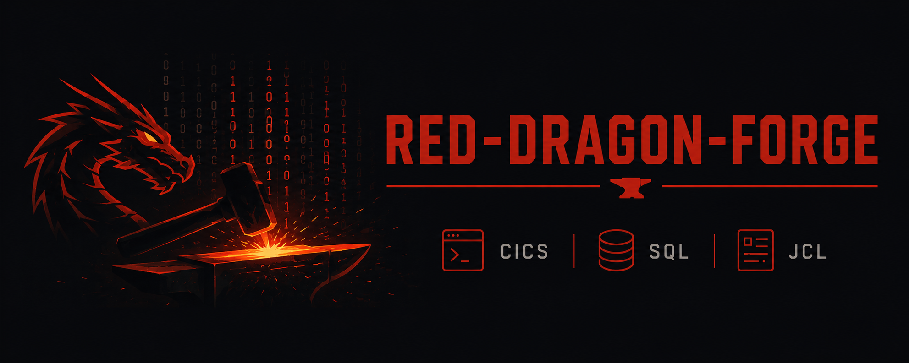

<p align="center">
  
</p>

# red-dragon-forge

**Monorepo for RedDragon's COBOL coprocessor runtimes, the composition layer that wires them
together, and the static analyser that reads the same corpora without running them.**

Each runtime emulates one legacy COBOL execution environment on top of
[RedDragon](https://github.com/avishek-sen-gupta/red-dragon) — a general-purpose
multi-language interpreter, vendored as a submodule and never modified by this repo.

| Package | What it is |
| --- | --- |
| [`cicada/`](cicada/) | The **CICS runtime**: pseudo-conversational transaction dispatch, VSAM KSDS file control, BMS screen handling. |
| [`squall/`](squall/) | The **EXEC SQL coprocessor runtime** for Db2-attached COBOL programs. |
| [`jackal/`](jackal/) | The **JCL/batch execution engine**: job/step orchestration, IDCAMS, generation data groups. |
| [`red_dragon_forge/`](red_dragon_forge/) | The **composition layer** — this repo's own code. |
| [`cobble/`](cobble/) | **Corpus onboarding and knowledge-graph extraction**, analysis only. |

**The composition layer** assembles multiple coprocessor extensions into one compiled,
runnable COBOL program — without any one runtime knowing about the others — via a generic
`CoprocessorSpec` seam (`interpreter.project.coprocessor_compile`, contributed to RedDragon
itself). See
[`docs/design/2026-07-04-cics-sql-composition-design.md`](docs/design/2026-07-04-cics-sql-composition-design.md).

**Cobble** parses and walks the ASG, and never lowers to IR or executes. On top of the
program/file/transaction graph it builds field-level byte dataflow: a source-level CFG,
variable dependency graphs, and a byte-range trace that follows a commarea across LINK
boundaries. Its pipeline runs from `cobble/` as the `cobble-*` entry points
(`uv run cobble-parse-corpus --config …` then `uv run cobble-build --config …`, TOML configs,
after `. ../bridge-env.sh`); the parse is the only stage that starts a JVM, and every stage after it reads the one ASG cache it wrote.

Each package was originally its own repository, merged in via `git subtree` with full history,
and each stays independently buildable and testable. What may import what is enforced by a root
[`.importlinter`](.importlinter) contract and recorded in
[`docs/design/2026-09-09-package-boundaries.md`](docs/design/2026-09-09-package-boundaries.md).

## Quick start

```bash
git clone --recurse-submodules git@github.com:avishek-sen-gupta/red-dragon-forge.git
cd red-dragon-forge
make setup      # init submodules + build hlasm_export + the ProLeap + JCL bridge JARs + uv sync --all-packages
make test-all   # every package's suite, building the shared JARs exactly once
```

`make test-all` expects a running Db2 for the two suites that talk to one — see
[Tests](#tests).

`make setup` builds the native `hlasm_export` binary (BMS symbolic-map generation) too, so it
needs CMake, Ninja and a C++ toolchain, and names whichever is missing; `make hlasm` builds it
alone. `. ./bridge-env.sh` exports `PROLEAP_BRIDGE_JAR`/`JCL_BRIDGE_JAR` for running a tool by
hand.

## Tests

Each package is independently testable from its own directory:

```bash
cd cicada && make test    # unit + integration + CardDemo e2e
cd squall && make test    # needs SQUALL_DB2_DSN + a running Db2 (make db2-up)
cd jackal && make test
cd cobble && uv run pytest    # no JVM, no Db2 — static analysis only
```

`make test-all` from the repo root runs every one of those plus `red-dragon-forge`'s own
composition-layer suite (`make test`), building the shared ProLeap + JCL bridge JARs exactly
once regardless of how many packages need them. The composition-layer suite needs the same
`SQUALL_DB2_DSN` as Squall for its one live-Db2 end-to-end test.

> **Db2 on a small VM fails in a way that doesn't look like a memory problem** — the container
> stays up and healthy while `db2sysc` is OOM-killed underneath it, surfacing as `SQL30081N`.
> Give the container VM 6 GiB or more and cap `INSTANCE_MEMORY`:
> [`docs/db2-container-memory.md`](docs/db2-container-memory.md).

## Issue tracking

Uses [Beads](https://github.com/gastownhall/beads) (`bd`). `.beads/` (the local Dolt working
DB) is gitignored; `issues/issues.jsonl` is the tracked git source of truth. See `CLAUDE.md`
for the full convention.
