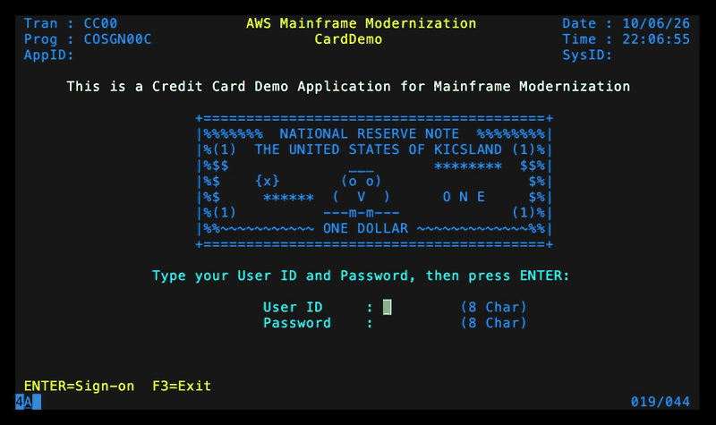
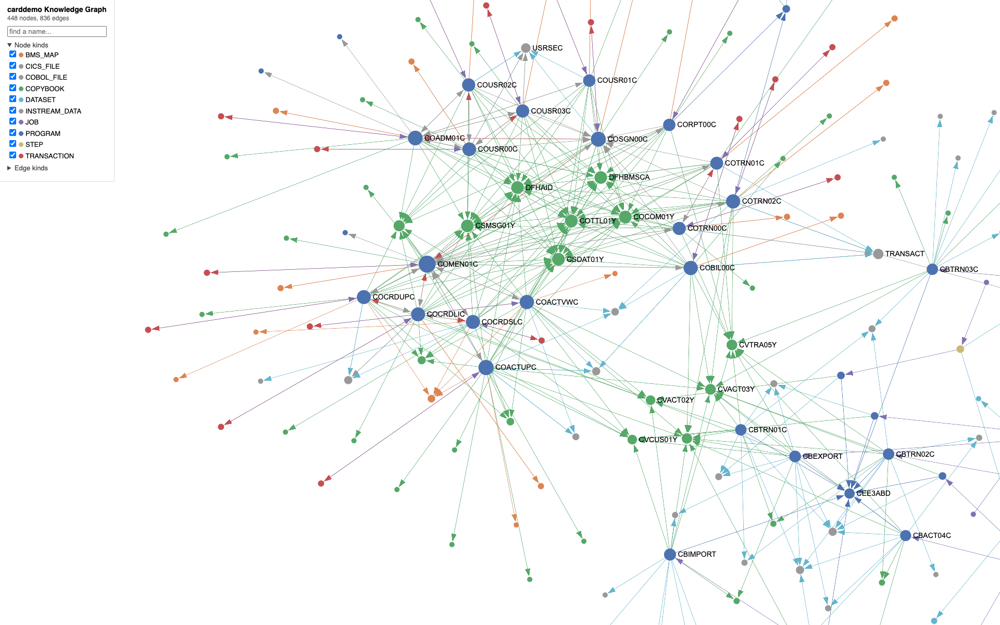

<p align="center">
  
</p>

# red-dragon-forge

Runtimes that execute mainframe COBOL programs on the
[RedDragon](https://github.com/avishek-sen-gupta/red-dragon) interpreter, a layer that composes
them, and a static analyser for the same code.

| Package | What it is |
|---|---|
| [`cicada/`](cicada/) | CICS runtime and TN3270 server |
| [`squall/`](squall/) | EXEC SQL runtime for Db2 programs |
| [`jackal/`](jackal/) | JCL/batch engine |
| [`catnip/`](catnip/) | System catalog: the datasets jobs and CICS regions share |
| [`litter/`](litter/) | Package: COBOL programs lowered once and linked into one image in a zip; `forge-build` writes one, `forge-run` runs it |
| [`red_dragon_forge/`](red_dragon_forge/) | Composition layer |
| [`cobble/`](cobble/) | Static analyser: knowledge graph, control flow, field dataflow |

CardDemo's online tier served by cicada to a stock `c3270`: a user updates an account, an admin
adds, updates and deletes a user.

<p align="center">
  
</p>

CardDemo's knowledge graph from cobble, zoomed in on the online programs: programs (blue)
linked to the copybooks (green), maps, transactions and files they use.

<p align="center">
  
</p>

## Quick start

```bash
git clone --recurse-submodules git@github.com:avishek-sen-gupta/red-dragon-forge.git
cd red-dragon-forge
make setup
```

Then:

- [Run CardDemo in a 3270 terminal](docs/how-to/run-carddemo.md)
- [Run your own COBOL application](docs/how-to/run-your-application.md)
- [Drive forge from Python](docs/how-to/drive-forge-from-python.md)
- [Run a JCL job](docs/how-to/run-jcl-job.md)
- [Analyse a COBOL corpus](docs/how-to/analyse-a-corpus.md)
- [Run the tests](docs/how-to/run-tests.md)

## Documentation

All documentation is indexed in [`docs/README.md`](docs/README.md).
