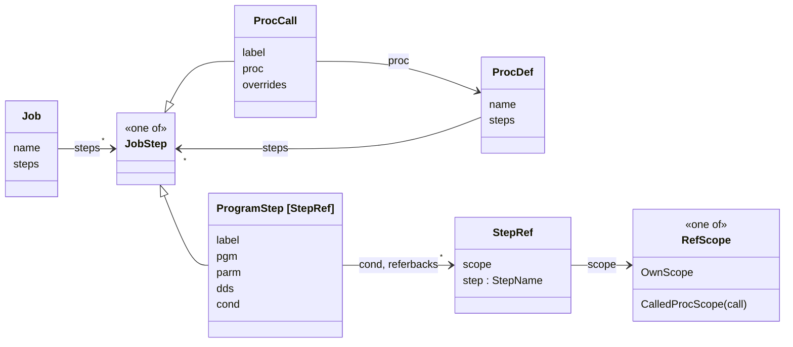
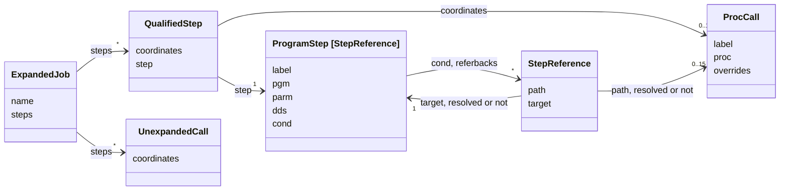
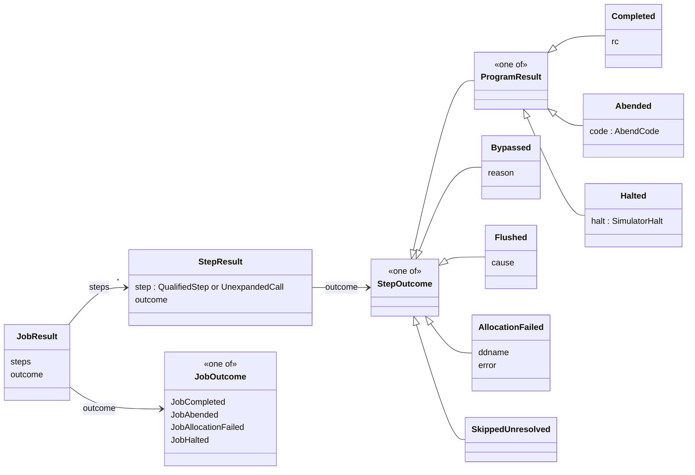
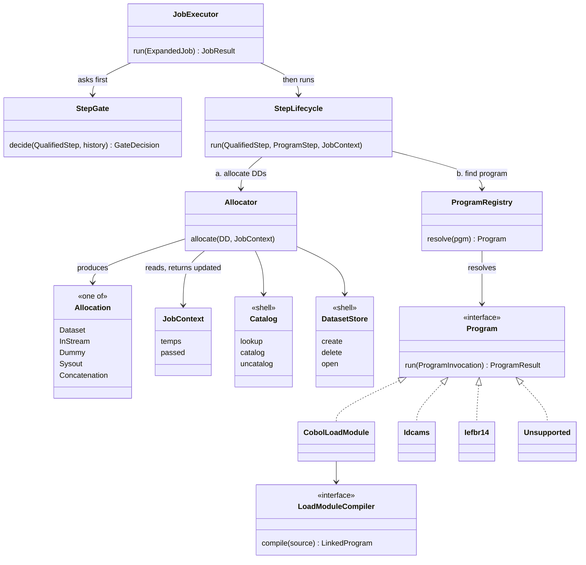

# jackal: job-level domain model (blueprint)

**Date:** 2026-10-10
**Status:** reviewed 2026-10-10; amended 2026-10-10: a reference after expansion is a path of
coordinates, each PROC, PROC call, program step and DD resolved or unresolved (§4.1, §4.2, §4.5,
§5, D6, D7). The JCL object model (parsed model and expansion) is built against it.
**Scope:** the types and interfaces for jackal's job-level execution, in the agreed order:
step outcomes (`red-dragon-forge-5fu`) → step lifecycle and allocator (`red-dragon-forge-lrk`) →
program dispatch (`red-dragon-forge-xkk`, `red-dragon-forge-355`) → job dataset context
(temps, `PASS`).
**Checked against:** z/OS 3.1 MVS JCL Reference (SA23-1385-60) and z/OS 2.5 MVS JCL User's Guide
(SA23-1386-50) on 2026-10-10; Appendix B lists what was confirmed, corrected, or found undocumented.
**Builds on:** [`docs/records/design/2026-10-05-jcl-to-be-architecture.md`](../../records/design/2026-10-05-jcl-to-be-architecture.md)
(component numbers `[n]` below are that record's).

---

## 1. Understanding

What was asked: a domain model, types and interfaces only, that serves job-level execution,
reviewed before any of the four issues is implemented.

Agreed earlier:

- Step and job level come first. GDG and the persistent system catalog (`93f`) are deferred.
- A COBOL step compiles the way cicada's programs do: `compile_program` with injected
  `CoprocessorSpec`s and `source_search_dirs` (`355`).
- The execution core is rebuilt behind the existing front end. The parser, the IDCAMS parser and
  `tso.py` stay.

Assumed, for you to correct:

- One run executes one job. The catalog is injected, so several jobs per run is a later change
  of lifetime, not of shape.
- `IF/THEN/ELSE` (`2cy.7`, `jackal-1o2.8`), the converter `[2]`, dataset attributes (`8in`),
  SORT/IEBGENER, the spool and `IKJEFT01` are out of scope. §12 shows where each attaches without
  changing a type defined here.

Success: every type below has one owner, one lifetime and one test seam; the four issues can be
implemented in order without changing a type an earlier issue introduced.

## 2. The design in brief

A JCL job is parsed into a `Job`: a list of EXEC statements, each either a program step
(`EXEC PGM=`) or a call to a PROC (`EXEC <proc>`). `expand_procs` inlines every PROC call it can
find, applies the call's overrides, and resolves every reference one step makes to another as far
as it can, recording for each entity on the way whether it was found. The result is an
`ExpandedJob`: the flat, ordered list of steps that will run, each a `QualifiedStep`, with an
`UnexpandedCall` standing in for each call whose PROC is in no library.

JCL has no loops and no jumps, so the executor walks that list once, front to back. For each step
the gate looks at what happened to earlier steps and decides whether this one runs. If it runs,
the lifecycle allocates its DDs, runs its program, and applies each DD's disposition. Every step
ends with exactly one `StepOutcome`, and the job's outcome is computed from them.

What lives for one job (temporary datasets and passed datasets) is an immutable `JobContext`, handed from step to step. Only the `Catalog` and the
`DatasetStore` change state on disk.

| Term | Meaning | JCL |
|---|---|---|
| program step | an EXEC statement that runs a program | `//S2 EXEC PGM=RPT` |
| PROC call | an EXEC statement that runs a PROC's steps in its place | `//S1 EXEC EXTR` |
| PROC | a named, reusable list of EXEC statements | `//EXTR PROC` … |
| reference | one step naming another | `COND=(4,LT,S1)`, `DSN=*.S1.OUT` |
| `StepRef` | a reference as written: a scope and a step name | `S1.P2` |
| coordinate | one entity on the way to a step (a PROC, a PROC call, a program step, a DD), resolved or unresolved | the `S1` in `S1.P2` |
| `StepReference` | a reference after expansion: a path of PROC-call coordinates and a target step coordinate | `S1.P2`, looked up |
| `QualifiedStep` | a step that will run, with the coordinates of the PROC calls that led to it | `P2` of the `EXTR` run by `S1` |
| stage | whether a type's references are still `StepRef`s or already `StepReference`s | — |
| gate | decides whether a step runs, from earlier outcomes | `COND=`, `EVEN`/`ONLY`, JOB `COND=` |
| allocation | a DD made ready for the program | `DSN=…,DISP=SHR`, `DD *`, `DD DUMMY` |
| disposition | what happens to a dataset when the step ends | the 2nd and 3rd `DISP` values |
| job context | datasets that live as long as the job | `&&RAW`, `DISP=(,PASS)` |

Names beginning `No`, `Not` or `Un` that hold no fields (`NoAbend`, `NotCataloged`,
`NotOverridden`, `ProcNotFound`, `Unallocated`, `Unnamed`) are null objects: empty frozen
dataclasses standing for "none", never `None`.

## 3. The model in diagrams

Three diagrams, each followed by how to read it. The sections after this one define every class
in full; these show how the classes relate.

### 3.1 Steps and references

There are two stages. In the parsed stage a reference to another step is only a name. In the
expanded stage it is the step itself. `expand_procs` turns the first into the second.

**Stage 1: parsed (what the JCL says)**



- A `Job` is a list of EXEC statements. Each is either a `ProgramStep` (`EXEC PGM=`) or a
  `ProcCall` (`EXEC <proc>`). A PROC's own steps have the same type, because a PROC can call a PROC.
- A program step refers to other steps in two places: its `COND=` and its DD referbacks
  (`DSN=*.S1.OUT`). Each reference is a `StepRef`: a step name, and the scope to look it up in.
  `OwnScope` is the scope the reference is written in; `CalledProcScope(S1)` is the steps of the
  PROC that call `S1` runs.
- `[StepRef]` marks that this step's references are still names.

**Stage 2: expanded (what will run)**



- An `ExpandedJob` is the list of steps that will run, in order. Each is a `QualifiedStep`: the
  coordinates of the PROC calls that led to the step (none for a step written directly in the
  job), plus the step. A call whose PROC is in no library stays as an `UnexpandedCall`.
- `[StepReference]` marks that this step's references have been looked up. Each `StepReference`
  is a path of PROC-call coordinates and a target program-step coordinate, and every coordinate is
  either resolved (holding the entity found) or unresolved (holding the name it was looked up by).

**How stage 1 becomes stage 2**

| Stage 1 | Stage 2 |
|---|---|
| `Job` | `ExpandedJob` |
| `ProgramStep [StepRef]` directly in the job | a new `ProgramStep [StepReference]`, in a `QualifiedStep` with no coordinates |
| `ProgramStep [StepRef]` inside a `ProcDef` | the call's overrides applied, then a new `ProgramStep [StepReference]`, in a `QualifiedStep` whose coordinates include that call |
| `ProcCall` whose PROC is found | replaced by its PROC's steps; kept, as a `ResolvedProcCall`, in each of their coordinates |
| `ProcCall` whose PROC is in no library | an `UnexpandedCall` whose coordinates end at it |
| `StepRef` | a `StepReference`, each coordinate resolved or unresolved |

**Example**

```
//PAYJOB  JOB (ACCT),'PAY'
//S1      EXEC EXTR
//S2      EXEC PGM=RPT,COND=(4,LT,S1.P2)

//EXTR    PROC
//P1      EXEC PGM=EXTPGM
//P2      EXEC PGM=SRTPGM,COND=(0,NE,P1)
```

| Step that runs | `QualifiedStep.coordinates` | `QualifiedStep.step` | Its reference: parsed → expanded |
|---|---|---|---|
| `P1` | `[S1 call]` | `P1` | none |
| `P2` | `[S1 call]` | `P2` | `StepRef(OwnScope, P1)` → path `[S1 call]`, target resolved `P1` |
| `S2` | `[]` | `S2` | `StepRef(CalledProcScope(S1), P2)` → path `[S1 call]`, target resolved `P2` |

### 3.2 Outcomes



- Every step that the job reached gets a `StepResult` with one `StepOutcome`.
- A program can only return a `ProgramResult`: it completed with a return code, abended, or the
  simulator could not run it (`Halted`).
- The other outcomes come from outside the program. The gate decides `Bypassed` (one of the
  step's own COND tests was true) and `Flushed` (something earlier ended the job: an abend, an
  allocation failure, or the JOB card's `COND`). The lifecycle decides `AllocationFailed` (a DD
  could not be allocated, so the program never started). Under `IgnoreStrategy` the executor
  records `SkippedUnresolved` for a call to a PROC in no library and for a step with an
  unresolved referback (D7); it has no IBM equivalent.
- `JobOutcome` is computed from the step outcomes: the first abend, allocation failure or halt
  decides it, otherwise the job completed with the highest return code.

### 3.3 Running a step



- The executor goes through the `ExpandedJob` one `QualifiedStep` at a time, carrying the results so far
  and a `JobContext`.
- For each step it asks the `StepGate` first: run it, or skip it as bypassed or flushed.
- If it runs, the `StepLifecycle` does three things in order:
  a. allocates every DD, through the `Allocator`, into an `Allocation`;
  b. finds the program in the `ProgramRegistry` and runs it with those allocations and the PARM;
  c. applies each DD's disposition according to the result.
- `JobContext` is what lives for one job: temporary datasets and passed datasets. It is an
  immutable value; each step returns an updated one.
- `Catalog` and `DatasetStore` are the only parts that change state: the catalog maps names to
  datasets, the store holds the files.
- `CobolLoadModule` compiles through `LoadModuleCompiler`, which calls red-dragon's
  `compile_program` with injected coprocessor specs, as cicada does.

## 4. The parsed model

Only where a feature in scope needs it. Every type here is a frozen dataclass whose fields are
tuples, so every value is hashable and can be a key.

### 4.1 Names, references and coordinates

A step is reached through a chain of statements: zero or more `EXEC PROC=` calls, then the step
itself. That chain is the step's coordinates. A reference names a step by such a chain; after
expansion, each entity on it records whether it was found.

```python
@dataclass(frozen=True)
class StepName:
    text: str

@dataclass(frozen=True)
class Unnamed: ...

type StepLabel = StepName | Unnamed

@dataclass(frozen=True)
class OwnScope: ...

@dataclass(frozen=True)
class CalledProcScope:
    call: StepName

type RefScope = OwnScope | CalledProcScope

@dataclass(frozen=True)
class StepRef:
    scope: RefScope
    step: StepName
```

- **`StepLabel`** is what a statement is called. JCL allows an unnamed `// EXEC`; `Unnamed` is its
  null object. Nothing can refer to an unnamed step.
- **`StepRef`** is a reference as written: a step name and the scope to look it up in. It holds
  names only, never a step.
  - `OwnScope`: a bare name. At job level it names a job step. Inside a PROC it names a step of
    the same PROC, or, failing that, a step of an enclosing PROC run or of the job (the JCL
    Reference allows a PROC step to name a job-level program step).
  - `CalledProcScope(S1)`: the steps of the PROC run by call `S1`. `S1.P1` is
    `StepRef(CalledProcScope(S1), P1)`. This is the longest form JCL has: no reference reaches
    two PROC levels down.
  - JCL resolves a name used more than once (one PROC called twice) to its first occurrence "in
    most cases", and calls the result unpredictable. The blueprint resolves an `OwnScope` name
    inside a PROC to the same run of that PROC, with a warning; see D6.

**Coordinates.** Every entity on the way a reference goes is a coordinate, and each kind of entity
has its own resolved and unresolved form. An unresolved coordinate holds only the name it was
looked up by.

```python
@dataclass(frozen=True)
class ResolvedProc:
    proc: ProcDef

@dataclass(frozen=True)
class UnresolvedProc:
    proc: ProcRef

type ProcCoordinate = ResolvedProc | UnresolvedProc

@dataclass(frozen=True)
class ResolvedProcCall:
    call: ProcCall
    proc: ProcCoordinate

@dataclass(frozen=True)
class UnresolvedProcCall:
    name: StepName

type ProcCallCoordinate = ResolvedProcCall | UnresolvedProcCall

@dataclass(frozen=True)
class ResolvedProgramStep:
    step: ProgramStep[StepReference]

@dataclass(frozen=True)
class UnresolvedProgramStep:
    name: StepName

type ProgramStepCoordinate = ResolvedProgramStep | UnresolvedProgramStep

@dataclass(frozen=True)
class ResolvedDd:
    dd: DD[StepReference]

@dataclass(frozen=True)
class UnresolvedDd:
    name: DdName

type DdCoordinate = ResolvedDd | UnresolvedDd

@dataclass(frozen=True)
class StepReference:
    path: tuple[ProcCallCoordinate, ...]
    target: ProgramStepCoordinate

@dataclass(frozen=True)
class QualifiedStep:
    coordinates: tuple[ResolvedProcCall, ...]
    step: ProgramStep[StepReference]

@dataclass(frozen=True)
class UnexpandedCall:
    coordinates: tuple[ResolvedProcCall, ...]
```

- **Each entity has its own resolution.** A call is resolved when the call exists, whatever its
  PROC: `//S1 EXEC SORTPROC` with SORTPROC in no library is `ResolvedProcCall(S1,
  UnresolvedProc(SORTPROC))`. Only the PROC is unresolved, and a step named inside it is an
  `UnresolvedProgramStep`.
- **Kind by position.** The kind of a name is known from where it stands, found or not: every name
  before the last in a reference is a PROC call, because only a call has steps under it, and the
  last is a program step, the only valid target.
- **`StepReference`** is a reference after expansion. It is fully resolved when every coordinate on
  it is resolved; otherwise its first unresolved coordinate says where the lookup stopped. A fully
  resolved reference names a `QualifiedStep`: its path is that step's coordinates and its target
  holds that step's `ProgramStep`.
- **`QualifiedStep`** is a step that will run: the coordinates of the PROC calls that led to it,
  each a call whose PROC was found, and the `ProgramStep`. z/OS nests PROCs up to 15 levels, so
  there are 0–15 coordinates. The `ProcCall`s in them are as written, with their overrides, so a
  qualified step also records how the step was reached.
- **`UnexpandedCall`** stands in the `ExpandedJob` for a call whose PROC is in no library. Its
  coordinates end at that call, whose PROC coordinate is `UnresolvedProc`; its steps are unknown.
- **Always finite.** A `ProgramStep [StepReference]` holds references to earlier steps only: JCL
  lets a reference name only an earlier step (`COND=` and `*.step.dd` alike), and `expand_procs`
  rejects any other with `ForwardReference`. References point only backwards and the structure
  never loops, so equality and hashing terminate. JCL has one same-step form, `DSN=*.ddname`,
  naming an earlier DD of the same step; it points backwards too, and is not modelled until a
  corpus needs it. PROCs cannot loop either: a PROC that calls itself, directly or through others,
  is `CircularProc`.
- **Uniqueness.** Two unnamed, identical steps under the same coordinates compare equal. No
  reference can name either, so nothing resolves ambiguously; the executor tells them apart by
  position in `ExpandedJob`.
- Rendering `S1.P1` happens only where text leaves: CLI output, cobble's graph node ids.

| Class | JCL it represents |
|---|---|
| `StepName` | the label in `//S1 EXEC …` → `StepName("S1")` |
| `Unnamed` | `// EXEC PGM=IEFBR14`, no label |
| `OwnScope` | `COND=(4,LT,S1)`, `DSN=*.S1.OUT`; inside a PROC, `COND=(0,NE,P1)` |
| `CalledProcScope` | the `S1.` in `COND=(4,LT,S1.P1)`, `DSN=*.S1.P1.OUT` |
| `StepRef` | `S1` → `StepRef(OwnScope(), S1)`; `S1.P1` → `StepRef(CalledProcScope(S1), P1)` |
| `ResolvedProc` / `UnresolvedProc` | the PROC that `//S1 EXEC EXTR` names, found in a library / in none |
| `ResolvedProcCall` / `UnresolvedProcCall` | the `S1` in `S1.P1`, when a call `S1` exists / when no step `S1` does |
| `ResolvedProgramStep` / `UnresolvedProgramStep` | the `P1` in `S1.P1`, found / not found or inside an unresolved PROC |
| `ResolvedDd` / `UnresolvedDd` | the `OUT` in `DSN=*.S1.OUT`, found on `S1` / not |
| `StepReference` | `COND=(4,LT,S1.P1)` after expansion |
| `QualifiedStep` | job step `//S2 EXEC PGM=RPT` → `QualifiedStep(coordinates=(), step=<S2>)`; step `P1` of the PROC called by `//S1 EXEC EXTR` → `QualifiedStep(coordinates=(<S1 call>,), step=<P1>)` |
| `UnexpandedCall` | `//S3 EXEC FTPPROC`, FTPPROC in no library |

How each kind of reference expands, in a job whose `//S1 EXEC SORTPROC` names a PROC in no library:

| JCL | `StepReference` after expansion |
|---|---|
| `COND=(4,LT,S1.SORT)` | path `(ResolvedProcCall(S1, UnresolvedProc(SORTPROC)),)`, target `UnresolvedProgramStep(SORT)` |
| `COND=(4,LT,S9.SORT)`, no step `S9` | path `(UnresolvedProcCall(S9),)`, target `UnresolvedProgramStep(SORT)` |
| `COND=(4,LT,NOPE)`, no step `NOPE` | path `()`, target `UnresolvedProgramStep(NOPE)` |
| `COND=(4,LT,S0)`, `S0` an earlier program step | path `()`, target `ResolvedProgramStep(<S0>)` |
| `DSN=*.S0.NOPE`, `S0` has no DD `NOPE` | a referback whose step is resolved and whose DD is `UnresolvedDd(NOPE)` (§4.5) |

### 4.2 Two stages, one parameter

A reference is a `StepRef` in the parsed `Job` and a `StepReference` once `expand_procs` has looked
it up. Every type that holds a reference takes that stage as a parameter, so the checker rejects an
expanded type holding a reference that was never looked up:

```python
type Stage = StepRef | StepReference
```

`R` below is bound to `Stage`. The parsed model is `[StepRef]`; `ExpandedJob` holds
`[StepReference]`. The parameter reaches `BypassTest`, `StepCondition`, `ProgramStep`, the IF
guards, `DSN` (through `BackwardRef`) and `DD`. Aliases keep call sites readable:
`WrittenDD = DD[StepRef]`, `ExpandedDD = DD[StepReference]`.

### 4.3 COND

```python
@dataclass(frozen=True)
class RcComparison:
    code: int
    op: CondOp

@dataclass(frozen=True)
class AllPriorSteps: ...

type CondTarget[R: Stage] = AllPriorSteps | R

@dataclass(frozen=True)
class BypassTest[R: Stage]:
    comparison: RcComparison
    target: CondTarget[R]

class AbendMode(Enum):
    NORMAL = "NORMAL"
    EVEN = "EVEN"
    ONLY = "ONLY"

@dataclass(frozen=True)
class StepCondition[R: Stage]:
    bypass_tests: tuple[BypassTest[R], ...]
    abend_mode: AbendMode
```

- A bypass test is a reason to skip, not a precondition: the step runs only when every test is
  false. Operands are reversed: `(4,LT)` means skip if 4 < RC.
- `EVEN`/`ONLY` is not a comparison, so it is not a `CondOp`. An EXEC `COND=` holds up to eight
  bypass tests, or up to seven plus one of `EVEN`/`ONLY`; they travel together as `StepCondition` because a
  COND override replaces both. The deserializer maps the bridge's `{"op":"EVEN"}` entry onto
  `abend_mode`.
- z/OS evaluates the `COND` on the first EXEC of a job as false, so the first step always runs.
- A JOB `COND=` is not a bypass test. After each step completes, z/OS checks the JOB card's
  comparisons against that step's RC; if one is true, the job ends and every remaining step is
  `Flushed(AfterJobCond(<that step>))`. It names no step and allows no `EVEN`/`ONLY`, so `Job`
  holds bare `RcComparison`s, in `end_job_tests`.

| Class | JCL it represents |
|---|---|
| `RcComparison` | `(4,LT)` |
| `AllPriorSteps` | a test with no step name: `COND=(4,LT)` |
| `BypassTest` | `(8,EQ,S1)` → `BypassTest(RcComparison(8, EQ), StepRef(OwnScope(), S1))` |
| `AbendMode` | `COND=EVEN` → `EVEN`; `COND=((4,LT),ONLY)` → `ONLY`; no `EVEN`/`ONLY` → `NORMAL` |
| `StepCondition` | a whole EXEC `COND=((4,LT),(8,EQ,S1),EVEN)` |
| `Job.end_job_tests` | `//PAYJOB JOB (ACCT),'PAY',COND=(8,LE)` → `(RcComparison(8, LE),)` |

### 4.4 DISP

```python
class DispNormal(Enum):
    PASS = "PASS"
    CATLG = "CATLG"
    UNCATLG = "UNCATLG"
    KEEP = "KEEP"
    DELETE = "DELETE"

class DispAbnormal(Enum):
    CATLG = "CATLG"
    UNCATLG = "UNCATLG"
    KEEP = "KEEP"
    DELETE = "DELETE"

@dataclass(frozen=True)
class Disp:
    status: DispStatus
    normal: DispNormal
    abnormal: DispAbnormal
```

Defaults stay in `_disp_from_words`, with one correction: when `normal` is `PASS` and `abnormal`
is omitted, `abnormal` is `DELETE` for a `NEW` dataset and `KEEP` otherwise (z/OS; `PASS` is not
an abnormal disposition).

| JCL | `Disp` |
|---|---|
| `DISP=(NEW,CATLG,DELETE)` | `(NEW, CATLG, DELETE)` |
| `DISP=SHR` | `(SHR, KEEP, KEEP)` |
| `DISP=(,PASS)` | `(NEW, PASS, DELETE)` |
| `DISP=(OLD,UNCATLG)` | `(OLD, UNCATLG, UNCATLG)` |
| no `DISP=` | `NotCoded`, whose disposition is `(NEW, DELETE, DELETE)` |

### 4.5 DSN and DD

```python
@dataclass(frozen=True)
class BackwardRef[R: Stage]:
    step: R
    dd: DdCoordinate

type DSN[R: Stage] = (
    DirectDSN | TempRef | BackwardRef[R] | InStreamDSN | DummyDSN | NoDSN | NullifiedDSN
)

@dataclass(frozen=True)
class NotCoded:
    def disposition(self) -> Disp: ...

@dataclass(frozen=True)
class ConcatMember[R: Stage]:
    dsn: DSN[R]
    disp: Disp | NotCoded
    in_stream: tuple[str, ...] = ()

@dataclass(frozen=True)
class DD[R: Stage]:
    ddname: DdName
    dsn: DSN[R]
    disp: Disp | NotCoded
    in_stream: tuple[str, ...] = ()
    sysout: bool = False
    concatenated: tuple[ConcatMember[R], ...] = ()
```

The other `DSN` variants are unchanged. `concatenated` is owned by `2cy.3`; the allocator needs
only this shape. cobble reads `in_stream` and `sysout` today, so they stay.

`NotCoded` records that no `DISP=` was written; `disposition()` gives the default for readers that
need one. It lets an override DD merge with the PROC's DD per parameter (JCL Reference pp. 28–29):

- A parameter the override does not write keeps the PROC's value: no DSN (`NoDSN`), no DISP
  (`NotCoded`), each concatenation member left blank.
- A parameter written with no value nullifies it: `DISP=` is the default `Disp`; `DSN=` is
  `NullifiedDSN`, which the merge turns into `NoDSN`. `NullifiedDSN` appears only in a parsed
  override; on any other DD, `DSN=` reads as `NoDSN`.
- `DUMMY` nullifies everything else. `SYSOUT`, a DSN or `*` nullifies a PROC's `DUMMY`.
- `SYSOUT` and `DISP` exclude each other: writing one nullifies the PROC's other.
- Concatenation members merge by position; extra members on either side are kept.

A referback is a reference to a step plus a DD on it. Parsed, its DD is always `UnresolvedDd`: it is
only a name until expansion looks at the step. Expanded, it is resolved only when its step reference
is fully resolved and that step has the DD; anything short of that (the step unresolved, or the step
found without the DD) leaves the DD coordinate `UnresolvedDd`, with the step reference showing which
entity was missing.

| Class | JCL it represents |
|---|---|
| `DirectDSN` | `DSN=PROD.TRANS` |
| `TempRef` | `DSN=&&RAW` |
| `BackwardRef` | `DSN=*.S1.OUT`, `DSN=*.S1.P1.OUT` |
| `InStreamDSN` | `//SYSIN DD *` followed by cards |
| `DummyDSN` | `//IN DD DUMMY`, `DSN=NULLFILE` |
| `NoDSN` | `//REPORT DD SYSOUT=*` (with `sysout=True`) |
| `NullifiedDSN` | `//P1.IN DD DSN=,DISP=OLD`, removing the PROC's DSN |
| `NotCoded` | the DISP of `//IN DD DSN=A.DATA` |
| `DD` | one `//ddname DD …` statement, with any concatenation |
| `ConcatMember` | each unnamed DD after a named one: `//IN DD DSN=A.DATA,DISP=SHR` then `//   DD DSN=B.DATA,DISP=SHR` |

### 4.6 Steps, PROC calls and PROCs

`EXEC PGM=` and `EXEC PROC=` are different statements with different fields. The grammar already
tells them apart (`execPgmStatement`, `execProcStatement`); the bridge emits which one it saw,
instead of jackal guessing from whether a `.prc` file exists.

```python
@dataclass(frozen=True)
class SymbolName:
    text: str

@dataclass(frozen=True)
class Symbol:
    name: SymbolName

@dataclass(frozen=True)
class ProgramStep[R: Stage]:
    label: StepLabel
    pgm: ProgramRef
    dds: tuple[DD[R], ...]
    cond: StepCondition[R]
    parm: Value = ()

@dataclass(frozen=True)
class NotOverridden: ...

@dataclass(frozen=True)
class ProcStepOverrides:
    cond: StepCondition[StepRef] | NotOverridden
    parm: Value | NotOverridden
    dds: tuple[WrittenDD, ...]

@dataclass(frozen=True)
class ProcCall:
    label: StepLabel
    proc: ProcRef
    symbol_overrides: tuple[tuple[SymbolName, Value], ...] = ()
    cond_for_every_step: StepCondition[StepRef] | NotOverridden = NotOverridden()
    parm_for_first_step: Value | NotOverridden = NotOverridden()
    dds_for_first_step: tuple[WrittenDD, ...] = ()
    per_step: tuple[tuple[StepName, ProcStepOverrides], ...] = ()

type JobStep = ProgramStep[StepRef] | ProcCall

@dataclass(frozen=True)
class ProgramRef:
    name: str

@dataclass(frozen=True)
class ProcRef:
    name: str

@dataclass(frozen=True)
class DdName:
    text: str

@dataclass(frozen=True)
class ProcDef:
    name: str
    defaults: tuple[tuple[SymbolName, Value], ...]
    steps: tuple[JobStep, ...]

@dataclass(frozen=True)
class Job:
    name: str
    steps: tuple[JobStep, ...]
    end_job_tests: tuple[RcComparison, ...] = ()
```

**Symbolic parameters** (`SYM=value`) are keyed by `SymbolName`, the same name a `Symbol` part
refers to and a PROC's defaults declare. Indirection lives on the value side: a `Value` may contain
`Symbol` parts, resolved against the caller's symbols. Blast radius: `value_parts.py`,
`proc_expand.py`, the deserializer, and cobble's two readers of `Symbol`.

**Keyword overrides** on a PROC call. Each field's name states its z/OS rule, applied by
`expand_procs` as it inlines each PROC step:

| JCL | Field | Rule |
|---|---|---|
| `COND=` | `cond_for_every_step` | replaces the COND of every step in the PROC, and of every nested PROC's steps (below) |
| `COND.P1=` | `per_step[P1].cond` | replaces the COND of `P1` only |
| `PARM=` | `parm_for_first_step` | sets the first step's PARM; nullifies PARM on every later step |
| `PARM.P1=` | `per_step[P1].parm` | replaces the PARM of `P1` only |
| `//SYSIN DD` before any qualified DD | `dds_for_first_step` | overrides or adds to the first step's DDs |
| `//SYSIN DD` after `//P2.X DD` | `per_step[P2].dds` | overrides or adds to the DDs of the step the last qualified DD named |
| `//P1.SYSIN DD` | `per_step[P1].dds` | overrides or adds to `P1`'s DDs |

- `NotOverridden` is distinct from an empty `Value`: `PARM=` with an empty value deliberately
  clears the PARM; no override leaves the PROC's own.
- `per_step` replaces today's `"P1.SYSIN"` ddname text, split on `.`. The bridge emits the
  procstep qualifier and the ddname separately.
- An unqualified override DD belongs to the step named by the nearest qualified DD above it, and
  to the first step only when none comes before it. The deserializer applies this rule, since it
  depends only on statement order.
- `PARM=` and `PARM.P1=` may both appear on one call; the unqualified one comes first and applies
  first, then each qualified one. When one step gets the same keyword twice, the last wins.
- An unqualified `COND=` reaches every level of nesting. The JCL Reference (p.326) says a calling
  EXEC's COND replaces the COND on every EXEC statement in the procedure; a nested call is one
  of those statements, and is itself a calling EXEC, so its replaced COND replaces its own PROC's
  steps in turn. Derived from that text: IBM gives no nested example, and it is not verified on
  z/OS.
- A keyword with an empty value nullifies it: `COND=` clears COND on every step,
  `PARM.P1=` clears `P1`'s PARM. An empty `StepCondition` and an empty `Value` represent these.
- An override names a step of the PROC this call invokes, never of a PROC nested inside it.
  To reach a nested step, JCL places the override inside the intermediate PROC, as an override on
  its own call, and expansion applies it there like any other.
- `TIME`, `REGION`, `ACCT`, `ADDRSPC`, `PERFORM`, `RD`, `DYNAMNBR` overrides parse and are not
  modelled: jackal simulates none of them. (Unlike PARM, these apply to every step when
  unqualified.)
- The bridge emits `execParameterOverrides` as overrides and stops attaching a PROC call's bare
  `COND=` to the calling step.

| Class | JCL it represents |
|---|---|
| `SymbolName`, `Symbol` | `&HLQ` in `DSN=&HLQ..TRANS` → `Symbol(SymbolName("HLQ"))` |
| `ProgramStep` | `//S2 EXEC PGM=RPT,PARM='X',COND=(4,LT)` and the DDs under it |
| `ProcCall` | `//S1 EXEC EXTR,HLQ=PROD,PARM.P1='FULL'` and the override DDs under it |
| `ProcStepOverrides` | everything on a call qualified with `P1`: `PARM.P1=`, `COND.P1=`, `//P1.SYSIN DD` |
| `NotOverridden` | a call that codes no `PARM.P1=` |
| `ProcDef` | a PROC: `//EXTR PROC HLQ=TEST` and its steps |
| `Job` | a JOB card and every statement after it |

## 5. Expansion

```python
@dataclass(frozen=True)
class ExpandedJob:
    name: str
    steps: tuple[QualifiedStep | UnexpandedCall, ...]
    end_job_tests: tuple[RcComparison, ...] = ()

@dataclass(frozen=True)
class ErrorSite:
    coordinates: tuple[ResolvedProcCall, ...]
    step: ProgramStep[StepRef]

@dataclass(frozen=True)
class ForwardReference:
    site: ErrorSite
    ref: StepRef

@dataclass(frozen=True)
class ReferenceToProcCall:
    site: ErrorSite
    ref: StepRef

@dataclass(frozen=True)
class PathThroughProgramStep:
    site: ErrorSite
    ref: StepRef

@dataclass(frozen=True)
class OverrideNamesNoStep:
    call: ProcCall
    step: StepName

@dataclass(frozen=True)
class CircularProc:
    procs: tuple[ProcRef, ...]

type JclError = (
    ForwardReference
    | ReferenceToProcCall
    | PathThroughProgramStep
    | OverrideNamesNoStep
    | CircularProc
)

class ProcLibrary(Protocol):
    def find(self, proc: ProcRef) -> ProcDef | ProcNotFound: ...

def expand_procs(job: Job, library: ProcLibrary) -> ExpandedJob | JclError: ...
```

`expand_procs` is the only place a `StepRef` becomes a `StepReference`, and it does four things:

1. Inlines each `ProcCall` whose PROC the library has, recursively, applying symbol overrides then
   the §4.6 keyword overrides. A call whose PROC is in no library becomes an `UnexpandedCall`.
2. Gives every resulting step its `QualifiedStep`.
3. Looks up every `StepRef` relative to the scope it was written in, recording each coordinate on
   the way as resolved or unresolved (§4.1). That covers `BypassTest` targets, IF guard terms and
   `BackwardRef` steps and DDs.
4. Returns a `JclError` value, before any step runs, only for mistakes in the JCL itself: a
   reference to the current step or a later one, a reference whose target is a PROC call, a
   reference whose path goes through a program step, an override naming a step the PROC does not
   have, or a PROC that calls itself.

- A name that matches nothing is not an error: it is an unresolved coordinate, and `expand_procs`
  logs a warning for every reference or referback that is not fully resolved (D6). How the
  executor treats such a reference is D7.
- An `UnexpandedCall` reaches the executor, which treats it under D7: the job is rejected before
  any step runs, or the call is recorded as `SkippedUnresolved`. cobble keeps drawing it as a
  node, as it does today.
- A `JclError` holds an `ErrorSite`: the coordinates and the step as written, since a step whose
  reference is in error has no expanded form.
- After expansion, the gate and the allocator meet only `StepReference`s, and can read off each
  one whether, and where, it is unresolved.
- `ProcLibrary` is injected; today it is a list of directories read with `Path`.

Blast radius: the deserializer, `proc_expand`, the runner, `cond.py`, and cobble's readers of
`Job` and of `expand_procs` output (`jcl_graph.py`, `corpus_index_builder.py`).

**Worked example.** A job and the PROC it calls:

```
//PAYJOB  JOB (ACCT),'PAY',COND=(8,LE)
//S1      EXEC EXTR,HLQ=PROD,PARM.P1='FULL'
//P2.OUT  DD DSN=&&SORTED,DISP=(NEW,PASS)
//S2      EXEC PGM=RPT,COND=(4,LT,S1.P2)
//IN      DD DSN=&&SORTED,DISP=(OLD,DELETE)
//REPORT  DD SYSOUT=*
//S3      EXEC FTPPROC
//S4      EXEC PGM=CHK,COND=(0,NE,S3.SEND)

//EXTR    PROC HLQ=TEST
//P1      EXEC PGM=EXTPGM
//IN      DD DSN=&HLQ..TRANS,DISP=SHR
//OUT     DD DSN=&&RAW,DISP=(NEW,PASS)
//P2      EXEC PGM=SRTPGM,COND=(0,NE,P1)
//IN      DD DSN=&&RAW,DISP=(OLD,DELETE)
//OUT     DD DSN=&&TMP,DISP=(NEW,PASS)
```

Parsed (`Job`, references as written):

```
Job(name=PAYJOB, end_job_tests=(RcComparison(8, LE),), steps=(
  ProcCall(label=S1, proc=EXTR,
           symbol_overrides=((HLQ, PROD),),
           per_step=((P1, ProcStepOverrides(cond=NotOverridden(), parm=FULL, dds=())),
                     (P2, ProcStepOverrides(cond=NotOverridden(), parm=NotOverridden(),
                                            dds=(DD OUT &&SORTED (NEW,PASS,DELETE),))))),
  ProgramStep(label=S2, pgm=RPT,
              cond=StepCondition((BypassTest((4,LT), StepRef(CalledProcScope(S1), P2)),), NORMAL),
              dds=(DD IN &&SORTED (OLD,DELETE,DELETE), DD REPORT SYSOUT)),
  ProcCall(label=S3, proc=FTPPROC),
  ProgramStep(label=S4, pgm=CHK,
              cond=StepCondition((BypassTest((0,NE), StepRef(CalledProcScope(S3), SEND)),), NORMAL))))
```

Expanded (`ExpandedJob`, references looked up), with `C1` = `ResolvedProcCall(<S1 call>,
ResolvedProc(EXTR))` and `C3` = `ResolvedProcCall(<S3 call>, UnresolvedProc(FTPPROC))`:

```
QualifiedStep(coordinates=(C1,), step=ProgramStep(P1, EXTPGM, parm=FULL,
         dds=(IN PROD.TRANS SHR, OUT &&RAW (NEW,PASS,DELETE))))
QualifiedStep(coordinates=(C1,), step=ProgramStep(P2, SRTPGM,
         cond=BypassTest((0,NE), StepReference(path=(C1,), target=ResolvedProgramStep(<P1>))),
         dds=(IN &&RAW (OLD,DELETE,DELETE), OUT &&SORTED (NEW,PASS,DELETE))))
QualifiedStep(coordinates=(), step=ProgramStep(S2, RPT,
         cond=BypassTest((4,LT), StepReference(path=(C1,), target=ResolvedProgramStep(<P2>))), …))
UnexpandedCall(coordinates=(C3,))
QualifiedStep(coordinates=(), step=ProgramStep(S4, CHK,
         cond=BypassTest((0,NE), StepReference(path=(C3,), target=UnresolvedProgramStep(SEND)))))
```

- `&HLQ..TRANS` became `PROD.TRANS`: the call's `HLQ=PROD` beat the PROC's default `TEST`.
- `PARM.P1='FULL'` reached `P1`. `//P2.OUT` replaced `P2`'s own `OUT`, so `&&TMP` is gone.
- `P1` inside the PROC and `S1.P2` at job level were written in different scopes; each resolved to
  the one step it names.
- `FTPPROC` is in no library, so `S3` is an `UnexpandedCall`. The call itself is resolved; only its
  PROC is not, so `S4`'s `S3.SEND` keeps the resolved `S3` call on its path and an unresolved
  `SEND` as its target, and expansion logs a warning for it.

## 6. Outcomes (`5fu`, component [13])

```python
@dataclass(frozen=True)
class SystemAbend:
    code: int

@dataclass(frozen=True)
class UserAbend:
    code: int

type AbendCode = SystemAbend | UserAbend

@dataclass(frozen=True)
class Completed:
    rc: int

@dataclass(frozen=True)
class Abended:
    code: AbendCode

@dataclass(frozen=True)
class UnsupportedProgram:
    pgm: str

@dataclass(frozen=True)
class StepBudgetExhausted:
    steps: int

type SimulatorHalt = UnsupportedProgram | StepBudgetExhausted

@dataclass(frozen=True)
class Halted:
    halt: SimulatorHalt

type ProgramResult = Completed | Abended | Halted

class BypassReason(Enum):
    COND_SATISFIED = "COND_SATISFIED"
    ONLY_WITHOUT_ABEND = "ONLY_WITHOUT_ABEND"

@dataclass(frozen=True)
class Bypassed:
    reason: BypassReason

@dataclass(frozen=True)
class AfterAbend:
    step: QualifiedStep

@dataclass(frozen=True)
class AfterAllocationFailure:
    step: QualifiedStep

@dataclass(frozen=True)
class AfterJobCond:
    step: QualifiedStep

type FlushCause = AfterAbend | AfterAllocationFailure | AfterJobCond

@dataclass(frozen=True)
class Flushed:
    cause: FlushCause

class AllocationError(Enum):
    DATASET_NOT_FOUND = "DATASET_NOT_FOUND"
    DUPLICATE_NAME = "DUPLICATE_NAME"
    TEMP_NOT_CREATED = "TEMP_NOT_CREATED"

@dataclass(frozen=True)
class AllocationFailed:
    ddname: DdName
    error: AllocationError

@dataclass(frozen=True)
class SkippedUnresolved:
    pass

type StepOutcome = (
    Completed | Abended | Halted | Bypassed | Flushed | AllocationFailed | SkippedUnresolved
)

@dataclass(frozen=True)
class StepResult:
    step: QualifiedStep | UnexpandedCall
    outcome: StepOutcome

@dataclass(frozen=True)
class JobCompleted:
    max_rc: int

@dataclass(frozen=True)
class JobAbended:
    step: QualifiedStep
    code: AbendCode

@dataclass(frozen=True)
class JobAllocationFailed:
    step: QualifiedStep
    failure: AllocationFailed

@dataclass(frozen=True)
class JobHalted:
    step: QualifiedStep
    halt: SimulatorHalt

type JobOutcome = JobCompleted | JobAbended | JobAllocationFailed | JobHalted

@dataclass(frozen=True)
class JobResult:
    steps: tuple[StepResult, ...]
    outcome: JobOutcome
```

- `StepResult` holds no program name: `step.step` already has it.
- `ProgramResult` is what a program may return; `StepOutcome` widens it with what only the
  executor and lifecycle decide. A program cannot claim it was bypassed.
- `Halted` is the simulator's limit, kept apart from the job's own behaviour. z/OS would give
  `S806` for a missing program and `S322` for a runaway; mapping them is decision D1.
- `JobOutcome` is derived by a pure function over `steps`: the first `Abended`, `AllocationFailed`
  or `Halted` decides it, else `JobCompleted(max rc over Completed)`. `SkippedUnresolved` never
  decides it, and later bypass tests skip it as they skip a step that did not run.
- A referback to a step that did not run is not a bypass reason: the name is copied and
  allocated, and fails as `AllocationFailed` if the dataset does not exist (`red-dragon-forge-552`).
- The outcomes arrive with the issues that produce them: `5fu` brings `Completed`, `Bypassed`,
  `Flushed(AfterJobCond)`, `SkippedUnresolved` and `JobCompleted`; abends (`jackal-1o2.19`),
  allocation failures (`552`, `8u3`) and halts (`xkk`, `w0e`) bring the rest.
- `results.py` stays a leaf (`.importlinter` `model-results-are-leaves`).

| Outcome | JCL situation that produces it |
|---|---|
| `Completed(4)` | the program ends with `RETURN-CODE` 4 |
| `Abended(UserAbend(4038))` | a COBOL program calls `CEE3ABD` with 4038 (D4) |
| `Abended(SystemAbend(0x0C7))` | a data exception in the program (D1) |
| `Halted(UnsupportedProgram("SORT"))` | `//S1 EXEC PGM=SORT` before SORT exists |
| `SkippedUnresolved()` | `//S3 EXEC FTPPROC`, no such PROC, under `IgnoreStrategy` (D7) |
| `Halted(StepBudgetExhausted(n))` | a `PERFORM` loop that never ends |
| `Bypassed(COND_SATISFIED)` | `COND=(4,LT)` after an earlier step's RC 8 |
| `Bypassed(ONLY_WITHOUT_ABEND)` | `COND=ONLY` when nothing abended |
| `Flushed(AfterAbend(S1))` | any later step without `EVEN`/`ONLY` once `S1` abended |
| `Flushed(AfterAllocationFailure(S1))` | every later step once `S1` failed allocation |
| `Flushed(AfterJobCond(S1))` | every later step once `S1` ended with RC 8 under JOB `COND=(8,LE)` |
| `AllocationFailed(IN, DATASET_NOT_FOUND)` | `//IN DD DSN=NO.SUCH,DISP=SHR` |
| `AllocationFailed(OUT, DUPLICATE_NAME)` | `//OUT DD DSN=PROD.TRANS,DISP=(NEW,CATLG)` when `PROD.TRANS` exists |
| `AllocationFailed(IN, TEMP_NOT_CREATED)` | `//IN DD DSN=&&X,DISP=OLD` with no earlier `NEW` |

For the worked example in §5, with every program ending RC 0: `P1`, `P2` and `S2` are
`Completed(0)`, `S3` is `SkippedUnresolved()`, and the job is `JobCompleted(0)`, under
`IgnoreStrategy`. Under `RaiseErrorStrategy` the job is rejected before `P1` runs (D7).

## 7. Executor (component [3])

```python
class JobExecutor(Protocol):
    def run(self, job: ExpandedJob) -> JobResult: ...

def run_job(job: Job, library: ProcLibrary, executor: JobExecutor) -> JobResult | JclError: ...
```

`run_job` is the entry point: expand, and if that yields a `JclError`, no step runs. The executor
is given an `UnresolvedReferenceStrategy` (D7) and applies it to the expanded job before the
first step; `RaiseErrorStrategy` rejects a job holding an unresolved reference there. Otherwise the
executor folds over `job.steps` in order, carrying a `StepHistory` and a `JobContext`, starting
from an empty context. For each `QualifiedStep` or `UnexpandedCall`:

1. Ask the gate (§8). A `Skip` records its `Bypassed` or `Flushed` outcome.
2. On `Run`, match the entry. An `UnexpandedCall`, and a step with an unresolved referback,
   record `SkippedUnresolved` (D7). A `QualifiedStep`'s `ProgramStep` goes to the lifecycle (§9.4), which returns the outcome and the
   next `JobContext`.
3. Append the `StepResult` to the history.

After the last step, the executor deletes, through `DatasetStore`, every temporary dataset and
every passed dataset created in this job that no later step received. Then it computes the
`JobOutcome` and returns the `JobResult`.

Why a single forward pass is enough: JCL has no loops, no GOTO, and no way to run a step twice.
`COND=`, `EVEN`/`ONLY`, the JOB `COND=` and, later, `IF/THEN/ELSE` only decide whether each step
runs. All of them live in the gate; the executor's loop never changes.

Pure: the gate, disposition selection, allocation planning, expansion and job-outcome derivation.
Shell: `DatasetStore` (files on disk), `Catalog` (the name index shared across a run) and the
COBOL adapter (the VM). Threading their state through as parameters would move the disk writes,
not remove them.

## 8. Step gate (component [4])

```python
@dataclass(frozen=True)
class Run: ...

@dataclass(frozen=True)
class Skip:
    outcome: Bypassed | Flushed

type GateDecision = Run | Skip

@dataclass(frozen=True)
class StepHistory:
    results: tuple[StepResult, ...]

    def completed_rcs(self, target: CondTarget[StepReference]) -> tuple[int, ...]: ...
    def first_abend(self) -> StepResult | NoAbend: ...
    def first_allocation_failure(self) -> StepResult | NoAllocationFailure: ...
    def first_job_cond_hit(self, end_job_tests: Sequence[RcComparison]) -> StepResult | NoJobCondHit: ...
    def ran(self, step: StepReference) -> bool: ...

def decide(
    entry: QualifiedStep | UnexpandedCall,
    end_job_tests: Sequence[RcComparison],
    history: StepHistory,
) -> GateDecision: ...
```

`decide` reads the entry's step. An `UnexpandedCall` has no bypass tests or abend mode of its own,
so it is gated as `NORMAL` with none; when the decision is `Run`, the executor records
`SkippedUnresolved` without entering the lifecycle. A bypass test whose reference is not fully
resolved is false, as for a step that did not run (D7).

Rules, in order; the first that applies decides:

1. The first step of the job → `Run`, whatever its COND says.
2. An earlier step failed allocation → `Flushed(AfterAllocationFailure)`, whatever `abend_mode` says.
3. An earlier completed step's RC satisfies a JOB `COND` comparison → `Flushed(AfterJobCond)`.
   This holds after an abend too, and beats `EVEN`.
4. An earlier step `Halted` → decision D2 (the stub/unsupported policy).
5. An earlier step abended: `NORMAL` → `Flushed(AfterAbend)`; `EVEN`/`ONLY` → go on to rule 7.
6. No earlier abend and `ONLY` → `Bypassed(ONLY_WITHOUT_ABEND)`.
7. One of the step's own bypass tests is true → `Bypassed(COND_SATISFIED)`; otherwise `Run`.

A referback to a step that did not run does not bypass anything; see §9.2.

A bypass test is a reason to skip, not a precondition: the step runs only when every test is
false. Tests read only `Completed` outcomes: the JCL Reference evaluates a test naming a bypassed
step as false, and RC tests ignore abended steps. Operands are reversed as today (`code op rc`).

## 9. Step lifecycle and allocation (`lrk`, components [5] [6])

### 9.1 Allocations

```python
class Positioning(Enum):
    START = "START"
    END = "END"

@dataclass(frozen=True)
class DatasetAllocation:
    dataset: Dataset
    positioning: Positioning

@dataclass(frozen=True)
class InStreamAllocation:
    lines: tuple[str, ...]
    dataset: Dataset

@dataclass(frozen=True)
class DummyAllocation:
    sink: Path

@dataclass(frozen=True)
class SysoutAllocation:
    sink: Path

type ReadableAllocation = DatasetAllocation | InStreamAllocation | DummyAllocation

@dataclass(frozen=True)
class ConcatenationAllocation:
    members: tuple[ReadableAllocation, ...]

type Allocation = (
    DatasetAllocation
    | InStreamAllocation
    | DummyAllocation
    | SysoutAllocation
    | ConcatenationAllocation
)

@dataclass(frozen=True)
class DdEnvironment:
    entries: tuple[tuple[str, Allocation], ...]

    def get(self, ddname: str) -> Allocation | Unallocated: ...
```

- `DISP=MOD` → `Positioning.END`. A COBOL `OPEN OUTPUT` on it must append; red-dragon's
  sequential driver truncates on `OUTPUT` today, so the COBOL adapter maps `OUTPUT` to `EXTEND`
  for that DD (needs a per-file mode seam in red-dragon; to verify).
- In-stream cards are materialised once as an 80-byte fixed-record EBCDIC dataset for programs
  that read the DD as a file (COBOL). The allocation also keeps the parsed `lines`, so a utility
  reading control statements (IDCAMS `SYSIN`) takes them directly and never decodes the file back.
- `DUMMY` and `SYSOUT` get a fresh empty sink, so reads hit EOF and writes go nowhere visible.
  Capturing `SYSOUT` is the spool (`1o2.7`), out of scope.
- STEPLIB/JOBLIB stop being a name list (`OPTIONAL_DDS`): a load-library DD allocates like any
  other and the COBOL adapter does not bind it.

| Allocation | JCL it represents |
|---|---|
| `DatasetAllocation(START)` | `//IN DD DSN=PROD.TRANS,DISP=SHR` |
| `DatasetAllocation(END)` | `//OUT DD DSN=PROD.LOG,DISP=MOD` |
| `InStreamAllocation` | `//SYSIN DD *` and its cards |
| `DummyAllocation` | `//IN DD DUMMY` |
| `SysoutAllocation` | `//REPORT DD SYSOUT=*` |
| `ConcatenationAllocation` | `//IN DD DSN=A.DATA,DISP=SHR` + `//   DD DSN=B.DATA,DISP=SHR` |
| `DdEnvironment` | every DD of one step, after allocation |

### 9.2 Allocator

```python
class Allocator(Protocol):
    def allocate(
        self, dd: ResolvedDD, context: JobContext
    ) -> tuple[Allocation, JobContext] | AllocationFailed: ...
```

Planning (which request a DD makes) is pure; materialising it goes through `DatasetStore` and
`Catalog`. Resolution of a `DSN`:

| DSN | Status | Result |
|---|---|---|
| `DirectDSN` | `OLD`/`SHR` | a passed dataset of that name in `JobContext`, else the catalog, else `DATASET_NOT_FOUND` |
| `DirectDSN` | `MOD` | as above, `END`; absent → created as `NEW` |
| `DirectDSN` | `NEW` | name already in the catalog or job context → `DUPLICATE_NAME`; else created, uncataloged until disposition |
| `TempRef` | `NEW` | created under a system-unique name, recorded in `JobContext` |
| `TempRef` | other | looked up in `JobContext`, else `TEMP_NOT_CREATED` |
| `BackwardRef` | any | the referenced DD's DSN is copied from the referenced `QualifiedStep`'s own DDs, then allocated by the rows above. Whether that step ran does not matter: if the dataset does not exist, allocation fails like any other (JCL Reference) |
| `InStreamDSN` | — | `InStreamAllocation` |
| `DummyDSN` | — | `DummyAllocation` |
| `NoDSN` with `sysout` | — | `SysoutAllocation` |

If any DD fails, the DDs already allocated in that step are released, `NEW` ones deleted, and
the step's outcome is `AllocationFailed`. The program does not run.

That is `StrictAllocation`, one of two `MissingDataStrategy` implementations injected into the
runner, separate from D7's `UnresolvedReferenceStrategy`: D7 is about missing code, this about
missing data. `LenientAllocation` is jackal's own: it allocates an empty dataset in place of
one not found or never created, overwrites on a duplicate name, logs a warning, and runs the
step, so a job can be run without all of its input data. The CLI uses it.

### 9.3 Disposition

```python
@dataclass(frozen=True)
class KeepDataset: ...
@dataclass(frozen=True)
class DeleteDataset: ...
@dataclass(frozen=True)
class CatalogDataset: ...
@dataclass(frozen=True)
class UncatalogDataset: ...
@dataclass(frozen=True)
class PassDataset: ...

type DispAction = KeepDataset | DeleteDataset | CatalogDataset | UncatalogDataset | PassDataset

def disposition_for(disp: Disp, result: ProgramResult) -> DispAction: ...
```

`Completed` → `disp.normal`; `Abended` → `disp.abnormal`; `Halted` → decision D2. Applied per
`DatasetAllocation`; in-stream, dummy and sysout allocations are always released.

| Action | JCL and outcome |
|---|---|
| `KeepDataset` | `DISP=SHR` or `(OLD,KEEP)` |
| `DeleteDataset` | `(OLD,DELETE)` completed; `(NEW,CATLG,DELETE)` abended |
| `CatalogDataset` | `(NEW,CATLG)` completed |
| `UncatalogDataset` | `(OLD,UNCATLG)` completed |
| `PassDataset` | `(NEW,PASS)` completed |

### 9.4 Lifecycle

```python
class StepLifecycle(Protocol):
    def run(
        self, qualified: QualifiedStep, step: ProgramStep[StepReference], context: JobContext
    ) -> tuple[StepOutcome, JobContext]: ...
```

Allocate every DD → resolve and run the program → dispose by result. `step` is `qualified.step`, already matched as a
program step by the executor, so the lifecycle never sees an `UnexpandedCall`.

## 10. Programs (`xkk`, `355`, component [10])

```python
@dataclass(frozen=True)
class ProgramInvocation:
    step: QualifiedStep
    dds: DdEnvironment
    parm: str

class Program(Protocol):
    def run(self, invocation: ProgramInvocation) -> ProgramResult: ...

class ProgramRegistry(Protocol):
    def resolve(self, pgm: str) -> Program: ...
```

`resolve` never fails: the last fallback is `Unsupported(pgm)`, a `Program` whose `run` returns
`Halted(UnsupportedProgram(pgm))`. Order: utilities → stubs (D2) → COBOL source found → unsupported.

| Program | Constructed with | Behaviour |
|---|---|---|
| `Iefbr14` | — | `Completed(0)`; its effect is the lifecycle |
| `Idcams` | `Catalog`, `DatasetStore` | AMS from the `SYSIN` allocation's `lines`; REPRO reads and writes through the `DdEnvironment` instead of allocating |
| `CobolLoadModule` | `LoadModuleCompiler`, the source | binds the `DdEnvironment` onto `RealFileIOProvider.path_overrides`; PARM as today; maps VM termination to a `ProgramResult` (D1) |
| `Unsupported` | the name | `Halted(UnsupportedProgram)` |

```python
class LoadModuleCompiler(Protocol):
    def compile(self, source: bytes) -> LinkedProgram: ...

class CoprocessorLoadModuleCompiler(LoadModuleCompiler):
    def __init__(
        self,
        parser: ProLeapCobolParser,
        specs: Sequence[CoprocessorSpec],
        source_search_dirs: Sequence[Path],
    ) -> None: ...
```

`compile` calls `compile_program(source, parser, specs, source_search_dirs=…)`, as cicada's
`_compile_one` does. `specs` is injected: standalone jackal passes none; `red_dragon_forge`
passes squall's and any LE stubs. No `ast_cache_dir` (red-dragon's `cobol_compile.py:137`: it
drops disk-resolved callees). jackal imports neither squall nor cicada.

`SourceLocator` (injected filesystem) answers "is there source for `PGM`" so dispatch never calls
`Path.read_text` directly.

| Program | JCL it represents |
|---|---|
| `Iefbr14` | `//S1 EXEC PGM=IEFBR14` |
| `Idcams` | `//S1 EXEC PGM=IDCAMS` with `//SYSIN DD *` holding `DELETE`, `DEFINE CLUSTER`, `REPRO` |
| `CobolLoadModule` | `//S2 EXEC PGM=RPT` where `RPT.cbl` exists, linked with what it `CALL`s |
| `Unsupported` | `//S1 EXEC PGM=SORT` before SORT exists |
| `ProgramInvocation.parm` | `PARM='FULL'`, after PROC overrides |

## 11. Job dataset context (component [7])

```python
@dataclass(frozen=True)
class TempName:
    job: str
    alias: str
    seq: int

@dataclass(frozen=True)
class PassedDataset:
    dsn: str
    dataset: Dataset
    created_in_job: bool

@dataclass(frozen=True)
class JobContext:
    temps: tuple[tuple[str, TempName], ...]
    passed: tuple[PassedDataset, ...]

    def with_temp(self, alias: str, name: TempName) -> JobContext: ...
    def with_passed(self, passed: PassedDataset) -> JobContext: ...
    def received(self, dsn: str) -> JobContext: ...
```

- A temp's backing name is derived from `TempName`, never from the alias text alone, so
  `&&EXTR` cannot collide with a dataset named `EXTR`.
- `PASS` puts the dataset on `passed`; a later `OLD`/`SHR` DD naming it receives it. At job end
  the executor deletes every temp and every unreceived passed dataset created in this job.
- Referbacks need no job state. A resolved `BackwardRef[StepReference]` holds the referenced step
  and DD themselves (`ResolvedProgramStep`, `ResolvedDd`), fixed by expansion, so the allocator
  reads the name from there. An unresolved one is D7.

| Class | JCL it represents |
|---|---|
| `TempName` | the first `&&RAW` created in `PAYJOB` → `TempName(PAYJOB, &&RAW, 1)` |
| `PassedDataset` | `//OUT DD DSN=PROD.EXTRACT,DISP=(NEW,PASS)`, waiting for a later `DISP=OLD` on that name |

### 11.1 Catalog and store (shell)

```python
class Catalog(Protocol):
    def lookup(self, dsn: str) -> Dataset | NotCataloged: ...
    def catalog(self, dataset: Dataset) -> None: ...
    def uncatalog(self, dsn: str) -> None: ...

class DatasetStore(Protocol):
    def create(self, name: str, spec: DatasetSpec) -> Dataset: ...
    def delete(self, dataset: Dataset) -> None: ...
    def open(self, dataset: Dataset, mode: OpenMode) -> FileOrganizationDriver: ...
```

One `Catalog` per run, injected; seeds are pre-cataloged entries. This is today's
`DatasetCatalog` split by responsibility, with no persistence and no GDG.

| Class | JCL it represents |
|---|---|
| `Catalog` | datasets seeded before the run, plus every `(NEW,CATLG)` completed during it |
| `DatasetStore` | the files behind every dataset, temp, in-stream and sink |

## 12. Deferred work

| Later | Attaches to | Type change here |
|---|---|---|
| `IF/THEN/ELSE` | a guard on `ProgramStep`, read by `decide` | `ProgramStep` gains a guard field; `GateDecision` unchanged |
| Converter / `TYPRUN=SCAN` | grows out of `expand_procs`, still producing `ExpandedJob` | none |
| Dataset attributes (`8in`) | `Dataset`, `DatasetStore` | `Dataset` gains attributes; allocations unchanged |
| GDG, persistent catalog (`93f`) | `Catalog`, `JobContext` | `JobContext` gains GDG bindings |
| `IKJEFT01` → squall (`46d`) | a `TsoMonitor` program with an injected port | registry entry |
| Spool (`1o2.7`) | `SysoutAllocation` | sink becomes a spool key |

### 12.1 IF/THEN/ELSE, when it comes

`IF/THEN/ELSE/ENDIF` looks like control flow but is a condition on each step inside it, so it
attaches to the gate and leaves the executor alone:

```python
type Guard = (
    Always | RcTest | HighestRcTest | AbendTest | AnyAbendTest | AbendCodeTest | RunTest
    | AllOf | AnyOf | Negated
)
```

| JCL | `Guard` |
|---|---|
| a step under no `IF` | `Always()` |
| `IF (S1.RC = 0) THEN` | `RcTest(S1, EQ, 0)` |
| `IF (RC > 4) THEN` | `HighestRcTest(GT, 4)`: highest RC of steps that ended normally so far, 0 at the start |
| `IF ABEND THEN` | `AnyAbendTest()` |
| `IF S1.ABEND THEN` | `AbendTest(S1)` |
| `IF S1.ABENDCC = U4038 THEN` | `AbendCodeTest(S1, UserAbend(4038))` |
| `IF S1.RUN THEN` | `RunTest(S1)`; `RUN` always needs a step name |
| `AND`, `OR`, `NOT` | `AllOf`, `AnyOf`, `Negated` |

- A step under `THEN` gets the IF's expression; a step under `ELSE` gets `Negated` of it.
- IFs nest up to 15 levels; a nested step's guard is `AllOf` its own and every enclosing one.
- A test on a step that did not run is false.
- An IF is evaluated once, when reached, and never re-examined.
- After an abend, a step still runs if its guard tests `ABEND`, `¬ABEND` or `ABENDCC`; other steps
  are flushed. A step with both a guard and a COND runs only when both say run.
- Some failures end the job whatever COND or IF say: an allocation failure, an operator cancel
  (`S122`/`S222`), a time limit.
- `expand_procs` attaches the guard as a field on `ProgramStep`; `decide` evaluates it as one more
  rule. `GateDecision` and the executor do not change.

## 13. Layering

`.importlinter` `layered-architecture` becomes:

```
jackal.cli
jackal.executor
jackal.lifecycle : jackal.gate
jackal.programs
jackal.allocation
jackal.job_context
jackal.catalog
jackal.model : jackal.results
```

Programs never import the lifecycle or the executor. `jackal.jcl` and `jackal.idcams` stay
independent. cobble keeps reading `jackal.model`, `jackal.dsn`, `jackal.value_parts`, `jackal.tso`,
`jackal.jcl.*`.

## 14. Testing

One test per behaviour.

- Unit (pure): `proc_expand` producing `ExpandedJob`: each §4.6 override rule (bare and
  procstep-qualified `COND`/`PARM`), `dds_for_first_step` and `per_step` DD overrides, nested PROCs, and an
  unknown PROC becoming `UnexpandedCall`; each kind of unresolved coordinate with its warning; and a symbol override resolving through a `Symbol` in its value;
  the gate's decision table (§8 rules 1–7, and the first-step rule), including a JOB `COND` hit flushing the rest;
  `disposition_for` for each outcome;
  allocation planning for each DSN × status row in §9.2; `JobOutcome` derivation;
  `_disp_from_words` defaults including `PASS`; `StepRef` resolution relative to its scope, and
  each `JclError`.
- Integration (files, VM, bridge): `COND=EVEN` and `((4,LT),EVEN)` parse; `UNCATLG` parses;
  a COBOL step with `SYSIN DD *` and `DD DUMMY`; `DISP=(NEW,CATLG,DELETE)` after an abend;
  `&&EXTR` beside a real `EXTR`; `PASS` received and unreceived; a main program `CALL`ing a
  subprogram that writes a DD (static and dynamic); a forge-level batch step with `EXEC SQL`
  under squall's spec; an unknown `PGM=`; an unknown PROC; a `JclError` stopping the job before
  any step runs; job-end cleanup deleting temps and unreceived passed datasets.

## 15. Order

Each is one committable unit and keeps the suite green.

1. **`5fu`:** §6 types, §7 executor loop, §8 gate, `QualifiedStep`/`StepRef`/`StepReference` and the coordinates, the stage parameter and the COND model (§4.1–§4.3), `DispAbnormal`/`UNCATLG`
   (§4.4), the step-kind split, `SymbolName` and PROC-call overrides with their bridge change (§4.6),
   and `expand_procs` returning `ExpandedJob | JclError` (§5). The runner still allocates as today but returns `JobResult` with outcomes.
2. **`lrk`:** §9 allocations, allocator, disposition, lifecycle; programs receive a
   `DdEnvironment`.
3. **`xkk` + `355`:** §10 registry, `Unsupported`, `CoprocessorLoadModuleCompiler`.
4. **Job context:** §11 `JobContext`, the `Catalog`/`DatasetStore` split, `PASS`, unique temps,
   and the executor's job-end cleanup (§7).

## 16. Decisions for you

- **D1. VM termination → outcome.** red-dragon raises assorted Python exceptions on failure and
  only logs when the step budget runs out. Options: (a) ask red-dragon upstream for a typed
  terminal state (ended, budget exhausted, fault) and map from it; (b) catch named exception types
  in the COBOL adapter. Separately: does a runaway or missing program report as `Halted` (as
  drafted) or as the abend z/OS would give (`S322`, `S806`)?
  *Decided (2026-10-11):* (a) for the budget: red-dragon's `RunOutcome` gained
  `BudgetExhausted` (red-dragon-lc7c), and a COBOL step that exhausts its per-program step
  budget is `Abended(SystemAbend(0x322))`. A missing program is `S806` (D2). No `Halted`.
  Faults raised as exceptions are still open.
- **D2. Effect of `Halted` and stubs on the job** (open since `xkk`): stop the job, or continue
  as if RC 0 or a configured RC. The same answer sets which disposition `Halted` applies.
  *Decided (2026-10-11):* a missing program is not `Halted`. An injected
  `MissingProgramStrategy` settles it: strict gives `Abended(SystemAbend(0x806))`, as z/OS does
  (abnormal disposition; later steps flushed unless `EVEN`/`ONLY`); lenient stubs every missing
  program as `Completed(0)` with a warning. No stub list. This also answers D1's missing-program
  half.
- **D3. Cataloging semantics.** With SMS (modern z/OS), a `NEW` dataset is cataloged at
  allocation, so `KEEP` behaves like `CATLG`. Without SMS, `NEW,KEEP` leaves it uncataloged and a
  later `DISP=OLD` by name fails. §9.2 is drafted non-SMS.
- **D4. How COBOL raises a user abend.** `CALL 'CEE3ABD'`/`'ILBOABN0'` needs a way to end the run
  unit with a code; red-dragon has none. LE stubs live in cicada (`cics/stubs`), which jackal
  cannot import. Options: move the stubs to red-dragon, or have forge supply them as a spec.
- **D5. Fidelity break in IDCAMS.** Allocating every DD before the program runs means a step that
  `DEFINE`s a cluster and `REPRO`s into it through an `OUTFILE` DD fails allocation, as on z/OS.
  If any existing test or CardDemo job relies on today's lenient order, keep z/OS behaviour and
  fix the job, or keep the leniency?
- **D6. References the JCL Reference leaves undefined.** Settled 2026-10-10. (a) A reference to a
  step or DD that does not exist, and a reference into a PROC that is in no library: no IBM text
  covers either. Each is an unresolved coordinate (§4.1), and expansion logs a warning; it is not a
  JCL error. (This replaced the first draft's `DanglingReference` and `DanglingDdReference`
  errors.) (b) A name used more than once, as when one PROC is called twice: IBM resolves to the
  first occurrence "in most cases" and calls the result unpredictable. Resolved to the same run of
  the PROC, with a warning.
- **D7. Running a step whose reference is unresolved.** Decided: an injected
  `UnresolvedReferenceStrategy`. z/OS rejects such a job at conversion, so both strategies are
  jackal's own behaviour.
  - `RaiseErrorStrategy` scans the expanded job and raises before any step runs, on the first
    `UnexpandedCall` or step whose bypass test or referback is unresolved.
  - `IgnoreStrategy` runs the job. A bypass test whose `StepReference` is unresolved is false, as
    for a step that did not run; the step's other tests still apply. An `UnexpandedCall`, and a
    step with an unresolved referback, are recorded with the jackal-only disposition
    `SKIPPED_UNRESOLVED` (no IBM equivalent), which later bypass tests skip as they skip a step
    that did not run.
  - IF terms are not covered: steps under an IF do not run yet.

## Appendix A. What the code does today

Read from the code on 2026-10-10. Items marked **(probed)** were reproduced through the bridge.

| Area | Today | Consequence |
|---|---|---|
| Outcome | `StepResult(name, return_code: int, ran: bool, disposition)` | A bypassed step reports RC 0; no abend; a VM exception escapes `run_job` and no `JobResult` exists |
| COND | `Cond(code, op, step: str)`, `step=""` meaning "all prior steps" | Text sentinel for "all"; no `EVEN`/`ONLY` |
| `COND=EVEN` **(probed)** | Bridge emits `op: "EVEN"`; `CondOp("EVEN")` raises | The whole job fails to parse |
| `COND=((4,LT),EVEN)` **(probed)** | `EVEN` dropped | Silent wrong semantics |
| COND inside a PROC | `proc_expand` renames inner steps to `"OUTER.INNER"` but never rewrites inner `COND` step references | An inner `COND=(4,LT,P1)` never matches `"S1.P1"` (read, not reproduced) |
| Step identity | `"OUTER.INNER"` built by string concatenation | Structure carried in a string |
| Step kind | One `Step` for `EXEC PGM=` and `EXEC PROC=`; `pgm` holds either a program or a PROC name; a PROC call is recognised by a `.prc` file existing | `parm` is meaningless on a PROC call, `proc_parms` on a program step; an unresolved PROC call reaches the runner as if it were a program |
| DD overrides on a PROC call | Keyed by ddname text `"P1.SYSIN"`, split on `.`; an unqualified override applies only to a single-step PROC, otherwise dropped | Structure carried in a string; on z/OS an unqualified override DD goes to the step named by the nearest qualified DD above it, or the first step if none |
| `DISP` **(probed)** | `DispNormal` lacks `UNCATLG`; abnormal shares the normal enum, so it admits `PASS` | `UNCATLG` fails the whole job; `(…,…,PASS)` is accepted though z/OS forbids it |
| Disposition | Only `DELETE` acts; abnormal never applied | `CATLG`/`KEEP`/`PASS` are no-ops |
| Allocation | Each program allocates; `catalog.allocate` raises `TypeError` on in-stream, DUMMY, NoDSN | DUMMY and `DD *` fail for COBOL steps (`lrk`) |
| `DISP=NEW` on an existing name | Overwritten with an empty file | z/OS fails the step |
| Dispatch | IEFBR14, IDCAMS, else `<pgm>.cbl` | Anything else crashes with `FileNotFoundError` (`xkk`) |
| COBOL compile | `run()` or `compile_cobol()` without search dirs or specs | No CALL closure, no `EXEC SQL`, no LE stubs (`355`) |
| VM step budget | red-dragon logs a warning and returns normally; `VMState` has no flag | A runaway program reports `Completed` with whatever RC was last published |
| PROC-call symbols | `proc_parms: dict[str, Value]`; keys come only from `SYM=value` on `EXEC PROC=` | The key is the same name as `Symbol.name` and `ProcDef.defaults` keys, held as bare `str` in three places |
| PROC-call keyword overrides | The grammar parses `COND=`, `COND.P1=`, `PARM.P1=` on `EXEC PROC=` as `execParameterOverrides`; the serializer emits none of them as overrides. A bare `COND=` there lands on the calling step, and `_inlined` drops the calling step's COND | COND on a PROC call never reaches the PROC's steps (read, not reproduced) |
| Temps | `&&EXTR` backed by file `EXTR` in the workdir, registered in the catalog as DSN `EXTR` | A real dataset named `EXTR` collides with the temp |

## Appendix B. Checked against IBM

Sources: z/OS 3.1 MVS JCL Reference, SA23-1385-60
(https://www.ibm.com/docs/en/SSLTBW_3.1.0/pdf/ieab600_v3r1.pdf); z/OS 2.5 MVS JCL User's Guide,
SA23-1386-50 (https://www.ibm.com/docs/en/SSLTBW_2.5.0/pdf/ieab500_v2r5.pdf); z/OS 3.1 MVS System
Messages Vol 8. Pages are the manuals' printed page numbers.

**Confirmed**

| Rule | Where it lands | Source |
|---|---|---|
| Unqualified `COND=` on a PROC call overrides or is added to every step; `COND.P1=` to `P1` only | §4.6 | Reference, "On an EXEC statement that calls a procedure" |
| Unqualified `PARM=` goes to the first step and nullifies PARM on the rest; `PARM.P1=` to `P1` only | §4.6 | same |
| `//P1.DD` overrides `P1`'s DD of that name, or adds it | §4.6 | Reference, "Coding an overriding … DD statement" |
| Overrides and references reach one PROC level only; `procstep.procstep.dd` is invalid | §4.1, §4.6 | Reference, nested-procedure rules; p.33 |
| PROCs nest up to 15 levels | §4.1 | Reference, "Nesting procedures" |
| `COND` and referbacks name an earlier step; a referback to a missing statement ends the job (IEF645I) | §4.1, §5 | Reference p.23, p.325; IEF645I |
| A `COND` or referback target must run a program, or be written `S1.P1` | §4.1, §5 | Reference p.23, p.325 |
| Inside a PROC, a bare `COND` name is a step of the same PROC, or a job-level program step | §4.1 | Reference p.325 |
| A test naming a bypassed step is false; RC tests skip abended steps | §8 | Reference p.323, p.325; User's Guide p.79 |
| `COND` on the first EXEC is evaluated as false | §8 rule 1 | Reference p.325 |
| JOB `COND` ends the job; EXEC `COND` is then ignored | §4.3, §8 | Reference p.399–400; User's Guide p.76 |
| After an abend, JOB `COND` is still tested for `EVEN`/`ONLY` steps, against normally ended steps, and beats `EVEN` | §8 rule 3 | User's Guide pp.80–81 |
| After an abend, steps without `EVEN`/`ONLY` are bypassed; `ONLY` with no abend does not run | §8 | User's Guide p.76; Reference p.328 |
| Up to 8 RC tests on EXEC, or 7 with `EVEN`/`ONLY`; up to 8 on JOB | §4.3 | Reference p.324, p.400 |
| An allocation failure ends the job whatever COND says | §8 rule 2 | Reference p.326 |
| IF: keywords, 15 nesting levels, false on a step that did not run, evaluated once, abend tests run after an abend, IF and COND must both say run | §12.1 | Reference pp.361–368 |

**Corrected in this blueprint**

| Was | Is | Source |
|---|---|---|
| A referback to a step that did not run bypasses the referencing step (today's code) | The name is copied regardless; allocation fails if the dataset does not exist. `PGM=*.` and `VOL=REF=*.` to such a step end the job. Gate rule and `REFERENCED_STEP_NOT_RUN` removed; `JobContext` no longer holds referbacks | IEF221I, IEF372I; Reference p.326 |
| An unqualified override DD goes to the first step | It goes to the step named by the nearest qualified DD above it, else the first | Reference, "Location in the JCL" |
| Up to eight tests plus `EVEN`/`ONLY` | Seven plus `EVEN`/`ONLY` | Reference p.324 |
| A bare name of a PROC-calling step is a possible target | It is not; `ReferenceToProcCall` | Reference p.23, p.325 |

**Not in IBM's documentation** (see D6)

- A `COND` naming a step that does not exist.
- Which occurrence a reused step name resolves to: "in most cases" the first, "results might be
  unpredictable".

**Do not copy semantics from** the Reference's p.328 Example 1, which inverts the operator table on
the same page, or from z/OS 2.1's Table 21, whose column headings were reversed (APAR OA44770).

**Still to check, in red-dragon**

- A per-file seam that opens a `DISP=MOD` dataset for `EXTEND` when a COBOL program opens it
  `OUTPUT` (§9.1).
- A typed terminal state for a run (ended, step budget exhausted, fault), which D1 depends on.
